Тема: SELinux - когда все запрещено 
```
Задание: 
1. Запустить nginx на нестандартном порту 3-мя разными способами:
 * переключатели setsebool;
 * добавление нестандартного порта в имеющийся тип;
 * формирование и установка модуля SELinux.

2. Обеспечить работоспособность приложения при включенном selinux.
 * развернуть приложенный стенд https://github.com/mbfx/otus-linux-adm/tree/master/selinux_dns_problems;
 * выяснить причину неработоспособности механизма обновления зоны (см. README);
 * предложить решение (или решения) для данной проблемы;
 * выбрать одно из решений для реализации, предварительно обосновав выбор;
 * реализовать выбранное решение и продемонстрировать его работоспособность.
```
Решение:
1. Запуск nginx на нестандартном порту 3-мя разными способами 
 * переключатели setsebool;
Проверка сервисов

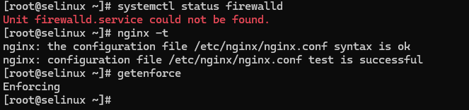

Разрешим в SELinux работу nginx на порту TCP 4881 c помощью переключателей setsebool
Смотрим в логах информацию о блокировании порта

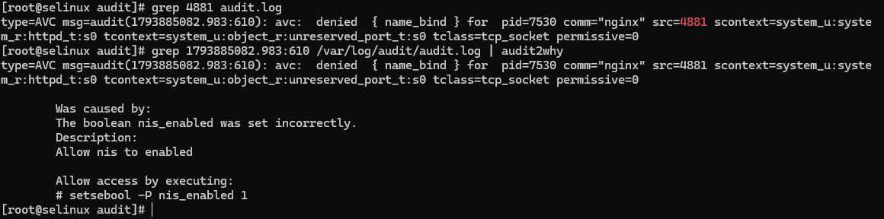

Включим параметр nis_enabled и перезапустим nginx и проверим:

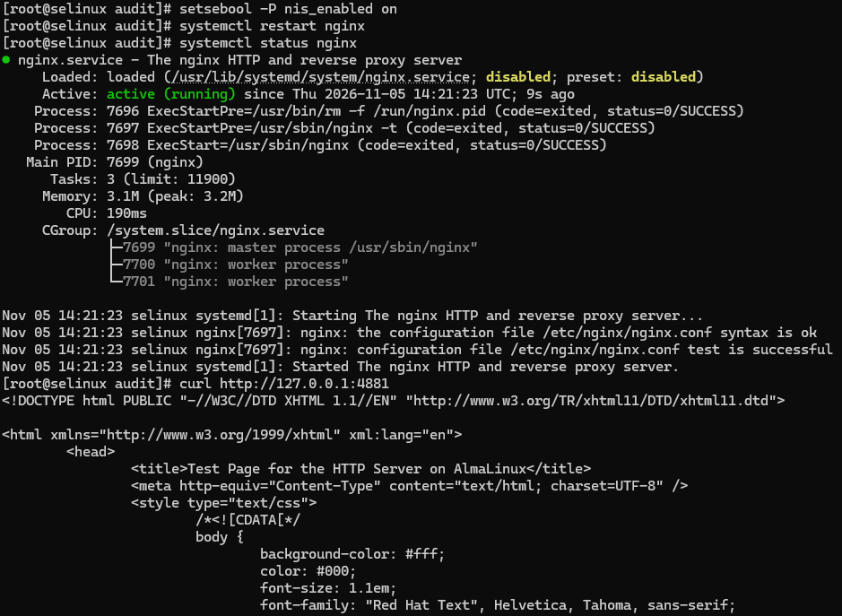

Вернём запрет работы nginx на порту 4881 обратно. Для этого отключим nis_enabled: 

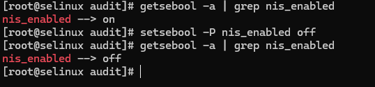

После отключения nis_enabled служба nginx снова не запустится.

*Теперь разрешим в SELinux работу nginx на порту TCP 4881 c помощью добавления нестандартного порта в имеющийся тип:
Поиск имеющегося типа и добавление порта в тип http_port_t:

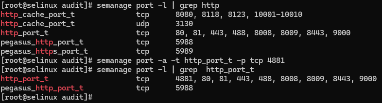

Проверяем

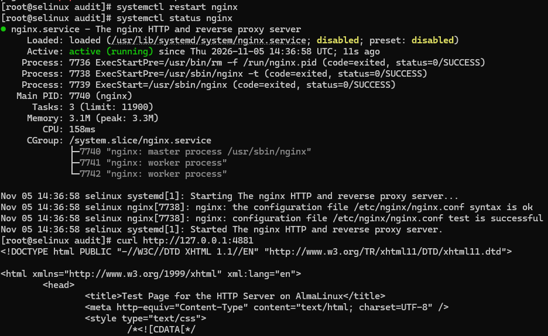

Удаляем нестандартный порт из имеющегося типа


*Разрешим в SELinux работу nginx на порту TCP 4881 c помощью формирования и установки модуля SELinux:
Воспользуемся утилитой audit2allow для того, чтобы на основе логов SELinux сделать модуль, разрешающий работу nginx на нестандартном порту. Создаем и применяем модуль и проверяем работу web сервера:

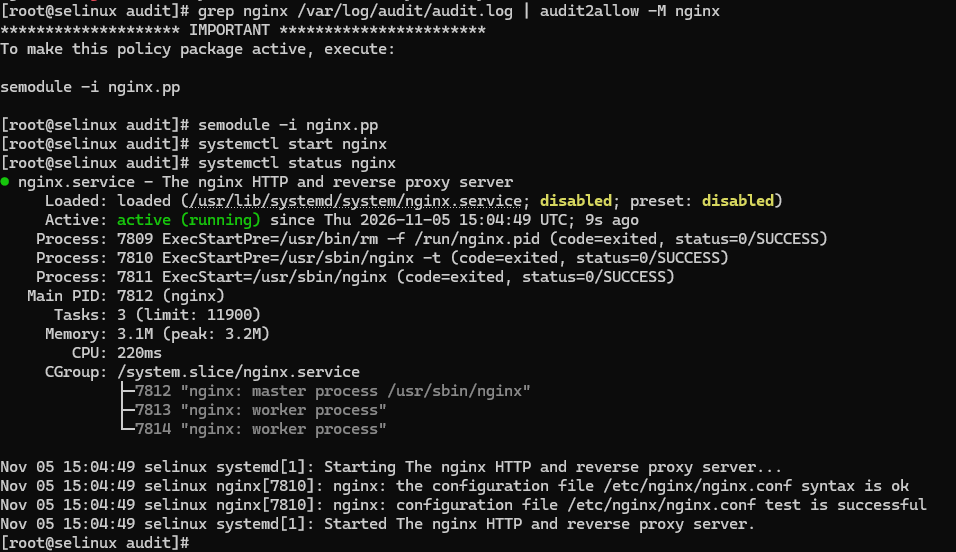

Удалить модуль можно следующей командой:
[root@selinux audit]# semodule -r nginx
libsemanage.semanage_direct_remove_key: Removing last nginx module (no other nginx module exists at another priority).


2. Обеспечить работоспособность приложения при включенном selinux.
* развернуть приложенный стенд https://github.com/mbfx/otus-linux-adm/tree/master/selinux_dns_problems;
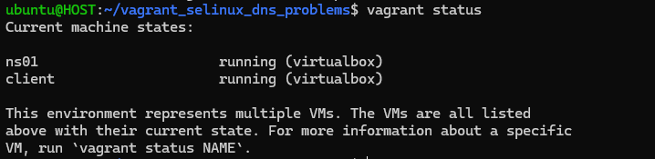

* выяснить причину неработоспособности механизма обновления зоны (см. README);
Проблема заключается в несоответствии контекста безопасности SELinux для каталога с файлами динамических DNS-зон.

* предложить решение (или решения) для данной проблемы;
- Постоянное изменение контекста безопасности через semanage fcontext
- Временное изменение контекста через chcon
- Перенос файлов зон в стандартный каталог /var/named

* выбрать одно из решений для реализации, предварительно обосновав выбор;
Оптимальным решением будет постоянное изменение контекста безопасности через semanage fcontext:
- У процесса нет права на запись во все конфигурационные файлы
- В отличие от chcon, правило записывается в локальную политику SELinux. Настройки не слетят после перезагрузки сервера или запуска restorecon

* реализовать выбранное решение и продемонстрировать его работоспособность.
Подключимся к клиенту и попробуем внести изменения в зону: nsupdate -k /etc/named.zonetransfer.key
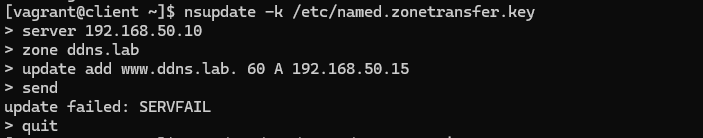

Изменения внести не получилось. Просмотр логов SELinux, утилитой audit2why результатов не дал.
Подключимся к серверу ns01 и проверим логи SELinux
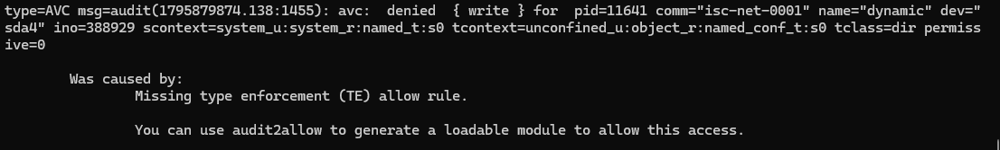

В логах мы видим, что ошибка в контексте безопасности. Целевой контекст named_conf_t.
Для сравнения посмотрим существующую зону (localhost) и её контекст:
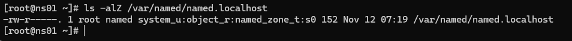

У наших конфигов в /etc/named вместо типа named_zone_t используется тип named_conf_t.
Проверим данную проблему в каталоге /etc/named:
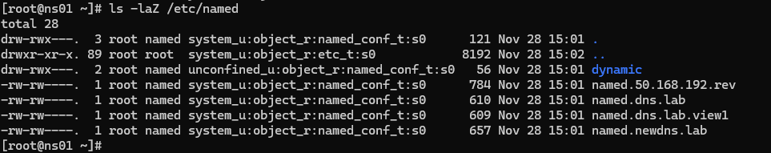

Тут видим что контекст безопасности неправильный. Проблема в том, что конфигурационные файлы лежат в другом каталоге. Смотрим в каком каталоге должны лежать файлы, чтобы на них распространялись правильные политики SELinux:
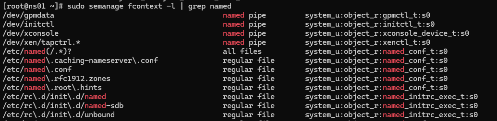

Изменим тип контекста безопасности для каталога /etc/named:
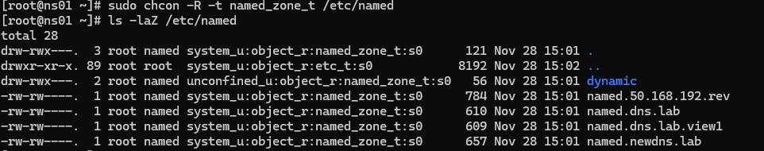

Попробуем снова внести изменения с клиента:
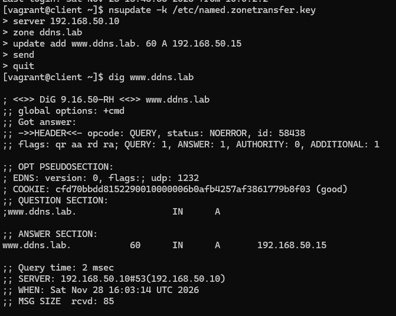

Изменения применились.
Мы не добавили новые правила в политику для назначения этого контекста в каталоге. Значит, что при перемаркировке файлов контекст вернётся на тот, который прописан в файле политики.
Для того, чтобы вернуть правила обратно, можно выполнить команду: restorecon -v -R /etc/named
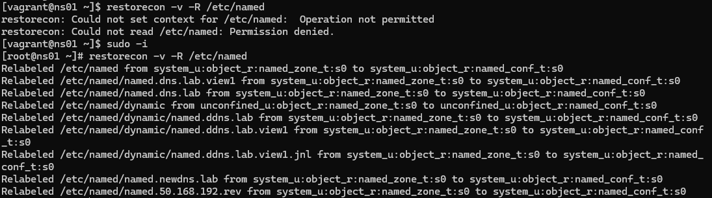
