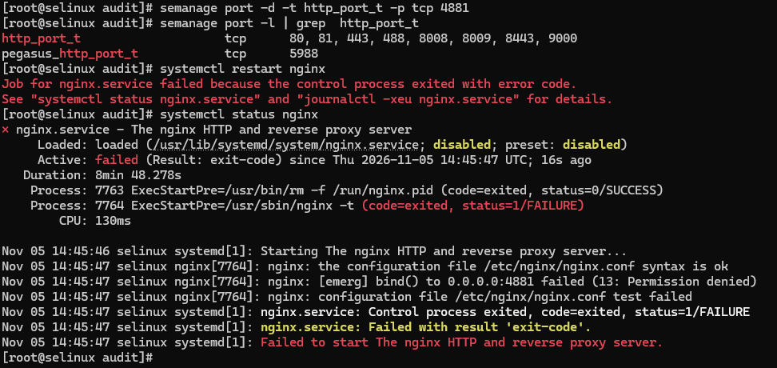

Тема: SELinux - когда все запрещено 
```
Задание: 
1. Запустить nginx на нестандартном порту 3-мя разными способами:
 * переключатели setsebool;
 * добавление нестандартного порта в имеющийся тип;
 * формирование и установка модуля SELinux.

2. Обеспечить работоспособность приложения при включенном selinux.
 * развернуть приложенный стенд https://github.com/mbfx/otus-linux-adm/tree/master/selinux_dns_problems;
 * выяснить причину неработоспособности механизма обновления зоны (см. README);
 * предложить решение (или решения) для данной проблемы;
 * выбрать одно из решений для реализации, предварительно обосновав выбор;
 * реализовать выбранное решение и продемонстрировать его работоспособность.
```
Решение:
1. Запуск nginx на нестандартном порту 3-мя разными способами 
 * переключатели setsebool;
Проверка сервисов


Разрешим в SELinux работу nginx на порту TCP 4881 c помощью переключателей setsebool
Смотрим в логах информацию о блокировании порта


Включим параметр nis_enabled и перезапустим nginx и проверим:


Вернём запрет работы nginx на порту 4881 обратно. Для этого отключим nis_enabled: 


После отключения nis_enabled служба nginx снова не запустится.

*Теперь разрешим в SELinux работу nginx на порту TCP 4881 c помощью добавления нестандартного порта в имеющийся тип:
Поиск имеющегося типа и добавление порта в тип http_port_t:


Проверяем


Удаляем нестандартный порт из имеющегося типа


*Разрешим в SELinux работу nginx на порту TCP 4881 c помощью формирования и установки модуля SELinux:
Воспользуемся утилитой audit2allow для того, чтобы на основе логов SELinux сделать модуль, разрешающий работу nginx на нестандартном порту. Создаем и применяем модуль и проверяем работу web сервера:


Удалить модуль можно следующей командой:
[root@selinux audit]# semodule -r nginx
libsemanage.semanage_direct_remove_key: Removing last nginx module (no other nginx module exists at another priority).
